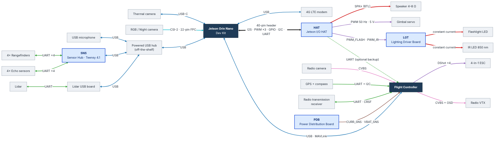
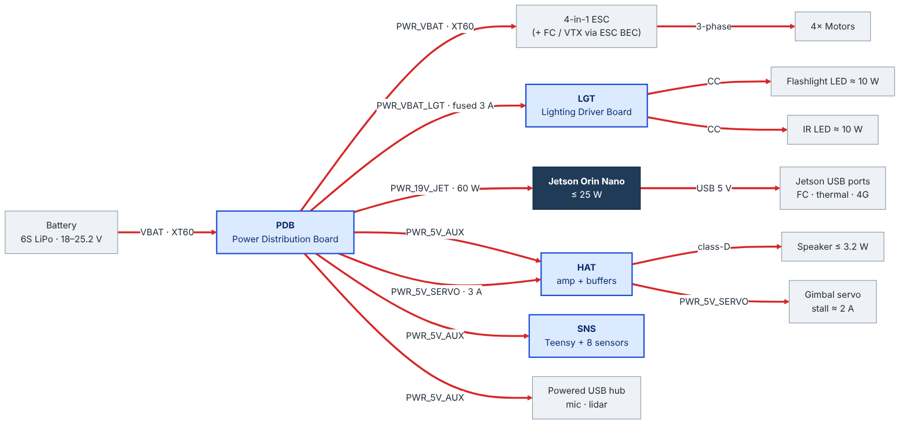
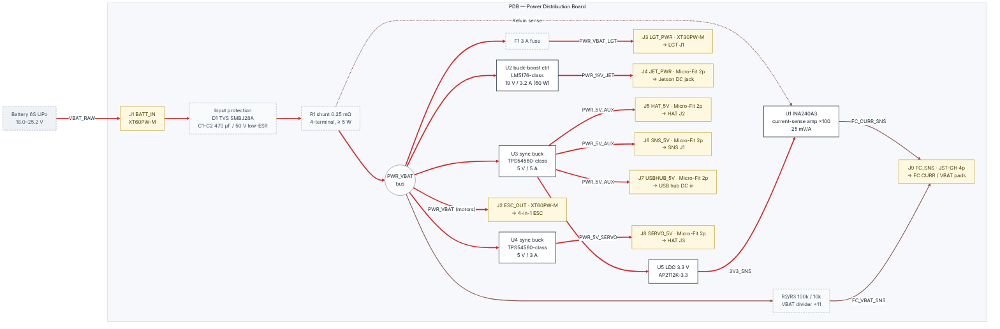
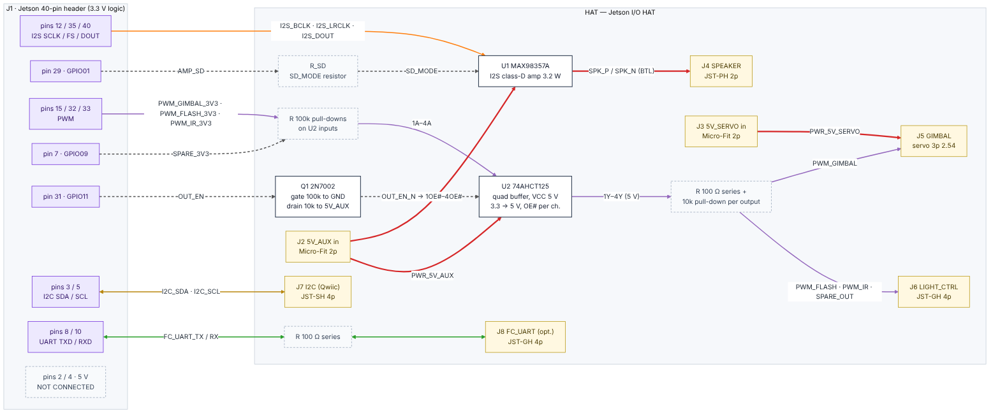
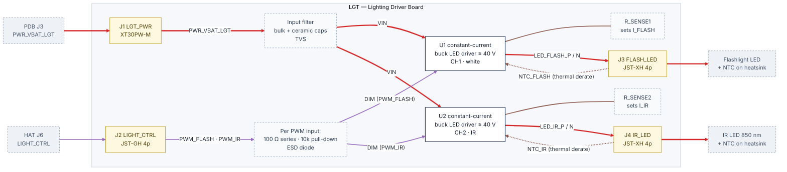
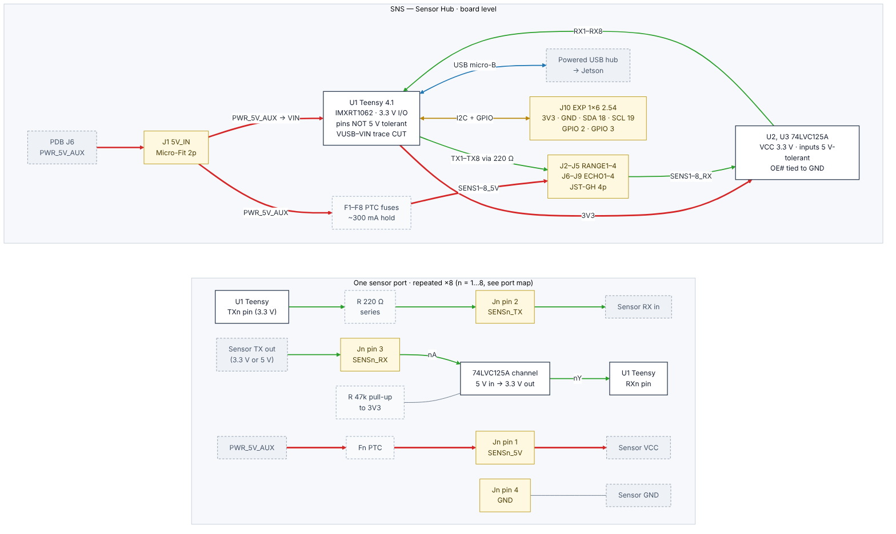

# Electrical & Logic Design — Rev A

This turns the [hardware block diagram](../hardware-diagram.md) into an
electrical and logic design you can capture directly in KiCad. It covers
the board split, every power rail, logic levels, the enable/safe-state
logic, each connector's pinout, and the cables between boards.

**Custom boards: 4.** Everything else is an off-the-shelf module.

| Board | Prefix | Job |
|-------|--------|-----|
| Power Distribution Board | `PDB` | Battery input, protection, current/voltage sensing for the FC, and every regulated rail |
| Jetson I/O HAT | `HAT` | Plugs onto the Jetson 40-pin header: I2S speaker amp, buffered PWM for the gimbal and lights, safe-at-boot enable logic |
| Lighting Driver Board | `LGT` | Two constant-current LED drivers (flashlight + IR), mounted near the emitters |
| Sensor Hub | `SNS` | Teensy 4.1 carrier with 8 protected, level-safe UART sensor ports |

Off-the-shelf: Jetson Orin Nano Dev Kit, flight controller, 4-in-1 ESC,
GPS, radio camera, radio transmission receiver, VTX, 4G LTE modem, powered
USB hub, lidar + its USB board, RGB/Night camera, thermal camera, USB
microphone, speaker, gimbal servo, LED emitters, rangefinders, echo sensors.

---

## 1. Assumptions — confirm before schematic capture

Each of these changes part choices. Anything marked here is a default, not a
measured requirement.

| Item | Assumed | What it drives |
|------|---------|----------------|
| Battery | 6S LiPo, 18.0–25.2 V. All regulators also work from 4S (≥ 12 V). | Voltage rating of every part on `PDB` and `LGT` |
| Compute | Jetson Orin Nano Developer Kit, powered at 19 V through its DC jack (the dev kit's adapter voltage) | `PDB` U2 output voltage, HAT pin map |
| Flight controller | MAVLink-capable FC (ArduPilot or PX4) with USB, an analog current pad and an analog voltage pad | `PDB` J9, Jetson ↔ FC link |
| Lidar | Unit with its own UART→USB adapter board (RPLIDAR-style) | No custom electronics needed |
| Rangefinders | UART single-point lidar (TF-Luna / TFmini-S class), 5 V supply | `SNS` ports 1–4 |
| Echo sensors | UART ultrasonic (A02YYUW class). Trigger/echo types also work — see §5.4 | `SNS` ports 5–8 |
| RGB/Night camera | MIPI CSI-2 on 22-pin FPC to the dev kit's camera connector | No custom electronics |
| Speaker | 4–8 Ω, ≤ 3 W | `HAT` U1 |
| Gimbal | One hobby servo, 50 Hz PWM, 5 V | `HAT` J5, `PDB` U4 |
| Lights | Bare LED emitters (no built-in driver), ≈ 10 W each, ≤ 1.5 A | `LGT` drivers. If your lights already have drivers, `LGT` becomes a MOSFET switch board |
| FPV | Analog radio camera → FC OSD → VTX. Receiver is ELRS/CRSF on UART | FC wiring only |

---

## 2. System diagrams

### 2.1 Signal interconnect



### 2.2 Power distribution



**Line colours (all diagrams):** red = power · blue = USB · green = UART ·
orange = I2S · purple = PWM / DShot · gold = I2C · brown = analog ·
pink = analog video · cyan = MIPI CSI-2 · grey dashed = GPIO / enable ·
thick black = multi-signal header.

### 2.3 USB port allocation

The dev kit has four USB-A ports, but six USB devices are needed. The
flight-critical and high-bandwidth links get direct ports; the rest share a
powered hub fed from `PWR_5V_AUX`.

| Jetson port | Device |
|-------------|--------|
| USB-A 1 | Flight controller (MAVLink) |
| USB-A 2 | Thermal camera (USB-C cable) |
| USB-A 3 | 4G LTE modem |
| USB-A 4 | Powered USB hub → Teensy (`SNS`), USB microphone, lidar USB board |

If the 4G modem browns out on transmit bursts, move it to the powered hub.

---

## 3. Net naming (use these as KiCad global labels)

Nets that cross a cable use the same name on both boards, so the cable list
in §6 can be checked against both schematics.

| Net | Level | From → To | Notes |
|-----|-------|-----------|-------|
| `PWR_VBAT` | 18–25.2 V, motor current | PDB → ESC | Unfused, after the shunt |
| `PWR_VBAT_LGT` | 18–25.2 V, ≤ 3 A | PDB → LGT | Fused (F1) |
| `PWR_19V_JET` | 19 V, ≤ 3.2 A | PDB → Jetson DC jack | |
| `PWR_5V_AUX` | 5 V, ≤ 5 A | PDB → HAT, SNS, USB hub | Logic, sensors, audio |
| `PWR_5V_SERVO` | 5 V, ≤ 3 A | PDB → HAT → servo | Kept apart from logic 5 V |
| `GND` | — | all | Star point at PDB |
| `FC_CURR_SNS` | 0–3.3 V analog, 25 mV/A | PDB → FC | FC scale: 40 A/V |
| `FC_VBAT_SNS` | 0–2.3 V analog, ÷11 | PDB → FC | FC voltage multiplier: 11.0 |
| `I2S_BCLK`, `I2S_LRCLK`, `I2S_DOUT` | 3.3 V | Jetson → HAT U1 | Jetson is I2S master |
| `AMP_SD` | 3.3 V | Jetson → HAT U1 SD_MODE | Low = amp off |
| `OUT_EN` | 3.3 V | Jetson → HAT Q1 | High = PWM outputs enabled |
| `PWM_GIMBAL` | 5 V, 50 Hz | HAT → servo | |
| `PWM_FLASH`, `PWM_IR` | 5 V | HAT → LGT | Dimming, ≥ 20 kHz recommended |
| `SPARE_OUT` | 5 V | HAT → LGT J2 pin 3 | Unused on LGT, routed for a future IR-cut or third light |
| `I2C_SDA`, `I2C_SCL` | 3.3 V | Jetson ↔ HAT J7 | Spare expansion |
| `FC_UART_TX`, `FC_UART_RX` | 3.3 V | Jetson ↔ FC | Optional backup to USB MAVLink |
| `SPK_P`, `SPK_N` | class-D BTL | HAT → speaker | Never tie either side to GND |
| `LED_FLASH_P/N`, `LED_IR_P/N` | constant current | LGT → emitters | |
| `NTC_FLASH`, `NTC_IR` | analog | emitter heatsinks → LGT | Thermal derating |
| `SENSn_5V`, `SENSn_TX`, `SENSn_RX` (n = 1…8) | 5 V / 3.3 V / 3.3–5 V | SNS ↔ sensors | `TX` = Teensy → sensor |

---

## 4. Logic-level rules

1. **Teensy 4.1 and Jetson header pins are 3.3 V and not 5 V tolerant.**
   Any signal that can arrive at 5 V passes through a 74LVC buffer powered
   from 3.3 V (LVC inputs accept 5 V when VCC = 3.3 V).
2. **Signals leaving the HAT are buffered** by a 74AHCT125 at 5 V. Its TTL
   input threshold reads 3.3 V as high, and it isolates the Jetson pins
   from cables.
3. **Safe state at boot:** PWM outputs are high-impedance with pull-downs
   until the Jetson sets `OUT_EN`; the amplifier stays shut down until it
   sets `AMP_SD`. So lights stay off, the servo gets no pulses, and the
   speaker stays silent while the Jetson boots or if it crashes into reset.
4. **Weak pulls on Jetson pins (≥ 47 kΩ).** NVIDIA dev-kit carriers usually
   level-shift the header from the SoC's 1.8 V, and strong pulls can upset
   those shifters.
5. **Separate supplies:** never connect `PWR_5V_AUX` to the Jetson header
   5 V pins (2, 4) or to the Teensy USB 5 V, so no supply back-feeds another.

---

## 5. Board designs

### 5.1 PDB — Power Distribution Board



**Blocks**

| Ref | Function | Part (or class) | Notes |
|-----|----------|-----------------|-------|
| J1 | Battery in | XT60PW-M (XT90 for higher motor current) | |
| D1 | Input TVS | SMBJ28A (28 V standoff) | Clamps ESC switching spikes |
| C1–C2 | Bulk | 470 µF, 50 V, low-ESR electrolytic | Close to J1/J2 |
| R1 | Shunt | 0.25 mΩ, 4-terminal (Kelvin), ≥ 5 W | Measures **total** battery current, not just motors |
| U1 | Current-sense amp | INA240A3 (gain 100), powered from 3V3_SNS | 25 mV/A → ≈ 130 A full scale. Use INA240A4 (×200) for ≤ 65 A systems |
| R2/R3 | VBAT divider | 100 kΩ / 10 kΩ, 0.1 % | 25.2 V → 2.29 V |
| F1 | Lighting fuse | 3 A | Size to 1.5–2× lighting load |
| U2 | `PWR_19V_JET` | 4-switch buck-boost controller, LM5176-class, 60 W | Buck-boost keeps 19 V across 4S–6S |
| U3 | `PWR_5V_AUX` | Sync buck, TPS54560-class, 5 A | |
| U4 | `PWR_5V_SERVO` | Same part as U3, set for 3 A | Isolates servo current spikes from logic |
| U5 | `3V3_SNS` | AP2112K-3.3 LDO from `PWR_5V_AUX` | Supplies U1 so `FC_CURR_SNS` can't exceed 3.3 V |
| LED1–4 | Rail-good indicators | 0603 LED + resistor per rail | |

**Connectors**

| Ref | Name | Type | Pin 1 | Pin 2 | Pin 3 | Pin 4 |
|-----|------|------|-------|-------|-------|-------|
| J1 | BATT_IN | XT60PW-M | + `VBAT_RAW` | − `GND` | | |
| J2 | ESC_OUT | XT60PW-M | + `PWR_VBAT` | − `GND` | | |
| J3 | LGT_PWR | XT30PW-M | + `PWR_VBAT_LGT` | − `GND` | | |
| J4 | JET_PWR | Micro-Fit 3.0, 2p | `PWR_19V_JET` | `GND` | | |
| J5 | HAT_5V | Micro-Fit 3.0, 2p | `PWR_5V_AUX` | `GND` | | |
| J6 | SNS_5V | Micro-Fit 3.0, 2p | `PWR_5V_AUX` | `GND` | | |
| J7 | USBHUB_5V | Micro-Fit 3.0, 2p | `PWR_5V_AUX` | `GND` | | |
| J8 | SERVO_5V | Micro-Fit 3.0, 2p | `PWR_5V_SERVO` | `GND` | | |
| J9 | FC_SNS | JST-GH 4p | `FC_CURR_SNS` | `FC_VBAT_SNS` | `GND` | NC |

### 5.2 HAT — Jetson I/O HAT



**Jetson 40-pin header (J1) usage**

| Pin | Jetson function | HAT net | Goes to |
|-----|-----------------|---------|---------|
| 1 | 3.3 V | `3V3_JET` | J7 pin 2 (Qwiic power) |
| 2, 4 | 5 V | **not connected** | — |
| 3 | I2C SDA | `I2C_SDA` | J7 pin 3 |
| 5 | I2C SCL | `I2C_SCL` | J7 pin 4 |
| 7 | GPIO09 | `SPARE_3V3` | U2 ch4 → `SPARE_OUT` |
| 8 | UART TXD | `FC_UART_TX` | 100 Ω → J8 pin 2 |
| 10 | UART RXD | `FC_UART_RX` | 100 Ω → J8 pin 3 |
| 12 | I2S SCLK | `I2S_BCLK` | U1 BCLK |
| 15 | GPIO12 / PWM | `PWM_GIMBAL_3V3` | U2 ch1 |
| 29 | GPIO01 | `AMP_SD` | R_SD → U1 SD_MODE |
| 31 | GPIO11 | `OUT_EN` | Q1 gate |
| 32 | GPIO07 / PWM | `PWM_FLASH_3V3` | U2 ch2 |
| 33 | GPIO13 / PWM | `PWM_IR_3V3` | U2 ch3 |
| 35 | I2S FS | `I2S_LRCLK` | U1 LRCLK |
| 38 | I2S DIN | — | Reserved for a future I2S microphone |
| 40 | I2S DOUT | `I2S_DOUT` | U1 DIN |
| 6, 9, 14, 20, 25, 30, 34, 39 | GND | `GND` | Ground plane |

The PWM and I2S pin functions must be enabled on the Jetson with
`sudo /opt/nvidia/jetson-io/jetson-io.py` before they work.

**U1 — MAX98357A (I2S class-D amp):** VDD = `PWR_5V_AUX`; GAIN pin left
floating (9 dB); SD_MODE driven from `AMP_SD` through R_SD, sized per the
datasheet's SD_MODE table for the (L+R)/2 mono mix; OUTP/OUTN → J4.

**U2 — 74AHCT125 (VCC 5 V) channel map**

| Ch | Input (A) | Output (Y) → connector | OE# |
|----|-----------|------------------------|-----|
| 1 | `PWM_GIMBAL_3V3` | `PWM_GIMBAL` → J5 pin 3 | `OUT_EN_N` |
| 2 | `PWM_FLASH_3V3` | `PWM_FLASH` → J6 pin 1 | `OUT_EN_N` |
| 3 | `PWM_IR_3V3` | `PWM_IR` → J6 pin 2 | `OUT_EN_N` |
| 4 | `SPARE_3V3` | `SPARE_OUT` → J6 pin 3 | `OUT_EN_N` |

Inputs have 100 kΩ pull-downs. Outputs have a 100 Ω series resistor and a
10 kΩ pull-down.

**Enable logic (Q1 2N7002):** gate = `OUT_EN` with 100 kΩ to GND; source = GND;
drain = `OUT_EN_N` with 10 kΩ pull-up to `PWR_5V_AUX`.

| `OUT_EN` (pin 31) | Q1 | `OUT_EN_N` | U2 outputs | Result |
|-------------------|----|------------|------------|--------|
| Low or floating (boot, reset) | off | High | Hi-Z → pulled low | Lights off, no servo pulses |
| High | on | Low | Follow inputs | Normal operation |

| `AMP_SD` (pin 29) | Amplifier |
|-------------------|-----------|
| Low or floating | Shut down |
| High (through R_SD) | On, (L+R)/2 mono |

**Connectors**

| Ref | Name | Type | Pin 1 | Pin 2 | Pin 3 | Pin 4 |
|-----|------|------|-------|-------|-------|-------|
| J1 | JETSON | 2×20 female, 2.54 mm | see table above | | | |
| J2 | 5V_AUX_IN | Micro-Fit 3.0, 2p | `PWR_5V_AUX` | `GND` | | |
| J3 | 5V_SERVO_IN | Micro-Fit 3.0, 2p | `PWR_5V_SERVO` | `GND` | | |
| J4 | SPEAKER | JST-PH 2p | `SPK_P` | `SPK_N` | | |
| J5 | GIMBAL | 1×3 male, 2.54 mm (servo) | `GND` | `PWR_5V_SERVO` | `PWM_GIMBAL` | |
| J6 | LIGHT_CTRL | JST-GH 4p | `PWM_FLASH` | `PWM_IR` | `SPARE_OUT` | `GND` |
| J7 | I2C (Qwiic) | JST-SH 4p | `GND` | `3V3_JET` | `I2C_SDA` | `I2C_SCL` |
| J8 | FC_UART (optional) | JST-GH 4p | NC | `FC_UART_TX` | `FC_UART_RX` | `GND` |

Add do-not-populate 4.7 kΩ I2C pull-up footprints. Fit them only if the
carrier has no pull-ups on pins 3/5.

### 5.3 LGT — Lighting Driver Board



| Ref | Function | Notes |
|-----|----------|-------|
| U1, U2 | Constant-current buck LED driver, ≥ 40 V input rating, with a PWM/DIM input (AL8860 or LM3409 class) | One per channel |
| R_SENSE1/2 | Sets LED current | Set to the emitter's rated current |
| Input filter | Bulk + ceramic caps, TVS | |
| PWM inputs | 100 Ω series, 10 kΩ pull-down, ESD diode | Pull-down keeps lights off if the cable is unplugged |

- Drive the DIM inputs at ≥ 20 kHz, or use the driver's analog-dim mode,
  so the lights don't cause flicker banding in the cameras.
- Check that each driver's DIM pin accepts 5 V logic.
- On 4S, the LED string's forward voltage must stay below ≈ 11 V for a
  buck driver to regulate.
- Use 2 oz copper and thermal vias under each driver; mount the board near
  the emitters.

| Ref | Name | Type | Pin 1 | Pin 2 | Pin 3 | Pin 4 |
|-----|------|------|-------|-------|-------|-------|
| J1 | LGT_PWR | XT30PW-M | + `PWR_VBAT_LGT` | − `GND` | | |
| J2 | LIGHT_CTRL | JST-GH 4p | `PWM_FLASH` | `PWM_IR` | `SPARE_OUT` (test pad) | `GND` |
| J3 | FLASH_LED | JST-XH 4p | `LED_FLASH_P` | `LED_FLASH_N` | `NTC_FLASH` | `GND` |
| J4 | IR_LED | JST-XH 4p | `LED_IR_P` | `LED_IR_N` | `NTC_IR` | `GND` |

### 5.4 SNS — Sensor Hub



- **U1 Teensy 4.1** sits in 2× 1×24 female headers. Cut the VUSB–VIN trace
  on its underside so the Jetson's USB 5 V and `PWR_5V_AUX` never connect;
  VIN is fed from J1.
- **U2, U3 74LVC125A**, VCC = Teensy 3V3, OE# tied to GND. They make each RX
  line safe for 3.3 V or 5 V sensors.
- **TX lines** leave the Teensy at 3.3 V through 220 Ω. Most 5 V sensors read
  3.3 V as high, and 3.3 V sensors aren't over-driven.
- **Per port:** PTC fuse (~300 mA hold) on 5 V; 47 kΩ pull-up to 3V3 on RX so
  an empty port idles high.
- **Trigger/echo sensors** use the same wiring: TXn becomes TRIG (GPIO out)
  and RXn becomes ECHO (GPIO in, through the 5 V-tolerant buffer).

**Port map** (pins per the PJRC Teensy 4.1 pinout card; check against it)

| Port | Conn | Sensor | Teensy UART | TX pin | RX pin | RX buffer |
|------|------|--------|-------------|--------|--------|-----------|
| 1 | J2 | Rangefinder 1 | Serial1 | 1 | 0 | U2 ch1 |
| 2 | J3 | Rangefinder 2 | Serial2 | 8 | 7 | U2 ch2 |
| 3 | J4 | Rangefinder 3 | Serial3 | 14 | 15 | U2 ch3 |
| 4 | J5 | Rangefinder 4 | Serial4 | 17 | 16 | U2 ch4 |
| 5 | J6 | Echo 1 | Serial5 | 20 | 21 | U3 ch1 |
| 6 | J7 | Echo 2 | Serial6 | 24 | 25 | U3 ch2 |
| 7 | J8 | Echo 3 | Serial7 | 29 | 28 | U3 ch3 |
| 8 | J9 | Echo 4 | Serial8 | 35 | 34 | U3 ch4 |

**Connectors**

| Ref | Name | Type | Pin 1 | Pin 2 | Pin 3 | Pin 4 | Pin 5 | Pin 6 |
|-----|------|------|-------|-------|-------|-------|-------|-------|
| J1 | 5V_IN | Micro-Fit 3.0, 2p | `PWR_5V_AUX` | `GND` | | | | |
| J2–J9 | RANGE1–4, ECHO1–4 | JST-GH 4p | `SENSn_5V` | `SENSn_TX` | `SENSn_RX` | `GND` | | |
| J10 | EXP | 1×6 male, 2.54 mm | `3V3` | `GND` | `I2C_SDA` (18) | `I2C_SCL` (19) | GPIO 2 | GPIO 3 |

---

## 6. Cable list

| Cable | From | To | Signals | Connector at board end | Wire |
|-------|------|----|---------|------------------------|------|
| C1 | Battery | PDB J1 | VBAT, GND | XT60 | 10–12 AWG |
| C2 | PDB J2 | ESC | `PWR_VBAT`, GND | XT60 | 10–12 AWG |
| C3 | PDB J3 | LGT J1 | `PWR_VBAT_LGT`, GND | XT30 | 18 AWG |
| C4 | PDB J4 | Jetson DC jack | `PWR_19V_JET`, GND | Micro-Fit → barrel plug matching the carrier | 18 AWG |
| C5 | PDB J5 | HAT J2 | `PWR_5V_AUX`, GND | Micro-Fit ↔ Micro-Fit | 20 AWG |
| C6 | PDB J6 | SNS J1 | `PWR_5V_AUX`, GND | Micro-Fit ↔ Micro-Fit | 20 AWG |
| C7 | PDB J7 | USB hub DC in | `PWR_5V_AUX`, GND | Micro-Fit → hub's DC plug | 20 AWG |
| C8 | PDB J8 | HAT J3 | `PWR_5V_SERVO`, GND | Micro-Fit ↔ Micro-Fit | 20 AWG |
| C9 | PDB J9 | FC current / voltage pads | `FC_CURR_SNS`, `FC_VBAT_SNS`, GND | JST-GH → FC pads/connector | 28 AWG |
| C10 | HAT J4 | Speaker | `SPK_P`, `SPK_N` | JST-PH | 22 AWG twisted |
| C11 | HAT J5 | Gimbal servo | GND, 5 V, PWM | Servo 3p | servo lead |
| C12 | HAT J6 | LGT J2 | `PWM_FLASH`, `PWM_IR`, `SPARE_OUT`, GND | JST-GH ↔ JST-GH | 28 AWG |
| C13 | HAT J8 | FC spare UART (optional) | TX, RX, GND (crossed at FC) | JST-GH | 28 AWG |
| C14 | LGT J3 | Flashlight LED + NTC | LED±, NTC, GND | JST-XH | 22 AWG |
| C15 | LGT J4 | IR LED + NTC | LED±, NTC, GND | JST-XH | 22 AWG |
| C16–C23 | SNS J2–J9 | Sensors 1–8 | 5 V, TX, RX, GND (crossed at sensor) | JST-GH → sensor's connector | 28 AWG |
| USB | Jetson / hub | FC, thermal cam, 4G, hub, Teensy, mic, lidar board | USB | — | per §2.3 |
| CSI | RGB/Night camera | Jetson camera connector | MIPI CSI-2 | 22-pin 0.5 mm FPC | — |

---

## 7. Power budget (estimates — replace with your parts' datasheet figures)

| Rail | Loads | Typical | Peak | Regulator | Headroom |
|------|-------|---------|------|-----------|----------|
| `PWR_19V_JET` | Jetson Orin Nano (incl. its USB ports) | 10–15 W | 25 W | 60 W (U2) | > 2× |
| `PWR_5V_AUX` | SNS: Teensy 0.1 A + 8 sensors ≤ 1.2 A · HAT: amp ≤ 0.8 A · USB hub ≤ 0.8 A | 1.5 A | 2.9 A | 5 A (U3) | ≈ 40 % |
| `PWR_5V_SERVO` | Gimbal servo | 0.2 A | ≈ 2 A stall | 3 A (U4) | ≈ 30 % |
| `PWR_VBAT_LGT` | Flashlight ≈ 10 W + IR ≈ 10 W | 0.5 A | 1.5 A (4S) | 3 A fuse (F1) | 2× |
| `3V3_SNS` | INA240 | < 5 mA | < 5 mA | AP2112K (U5) | large |
| `PWR_VBAT` | ESC + motors | frame-dependent | frame-dependent | XT60/XT90 + shunt | set by motor choice |

---

## 8. KiCad setup

- **One KiCad project per board:** `hardware/pdb`, `hardware/hat`,
  `hardware/lgt`, `hardware/sns`. Use one hierarchical sheet per block in §5
  (e.g. PDB: `input_protection`, `current_sense`, `rail_19v`, `rail_5v_aux`,
  `rail_5v_servo`, `connectors`).
- **Labels:** use the §3 net names as global labels, and give connectors the
  §5 reference designators so the §6 cable list checks against each
  schematic.
- **Net classes:**
  - `HighCurrent` (`PWR_VBAT`, `VBAT_RAW`): copper pours, 2 oz outer copper, stitching vias.
  - `Power` (19 V / 5 V rails): ≥ 1.0 mm traces or pours.
  - `Default` (signals): 0.25 mm.
  - Kelvin traces from R1 to U1 run as a tight pair.
- **Stack-ups:**
  - PDB: 4-layer, 2 oz outer, solid ground plane on L2.
  - HAT, LGT, SNS: 2-layer. LGT uses 2 oz copper with thermal vias.
- **Footprints:** XT60PW-M, XT30PW-M, Molex Micro-Fit 3.0 right-angle,
  JST-GH SM04B-GHS-TB, JST-PH, JST-XH, JST-SH SM04B-SRSS-TB, 2×20 2.54 mm
  female header, Teensy 4.1 (2× 1×24).
- **HAT outline:** check clearance against the Orin Nano heatsink and fan
  before fixing the board size and stand-off holes.

---

## 9. Open questions

1. Battery cell count and maximum motor current (sets J1/J2, the shunt, and the INA240 gain).
2. Exact rangefinder and echo sensor models (UART vs. trigger/echo, supply voltage).
3. Light emitters: wattage, forward voltage, current, and whether they include drivers.
4. Gimbal: one axis or two (a second servo needs one more PWM; Jetson header pin 7 can take it in place of `SPARE_3V3`).
5. Flight controller model and firmware (sets the analog-sense pinout and scale factors).
6. Does the RGB/Night camera have a switchable IR-cut filter? If so, `SPARE_OUT` can drive it.

---

## Regenerating the diagrams

```bash
cd diagrams
python3 build.py                        # writes the .mmd sources
for f in *.mmd; do npx -p @mermaid-js/mermaid-cli mmdc -i "$f" -o "${f%.mmd}.png" -b white -s 2; done
```
