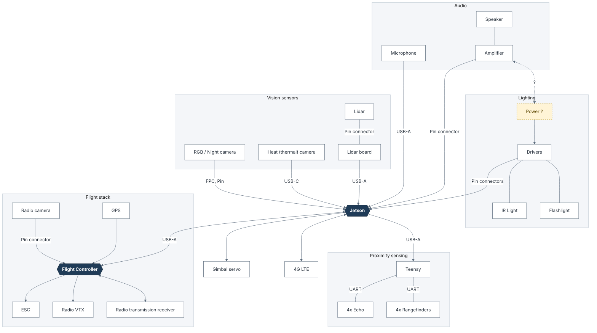
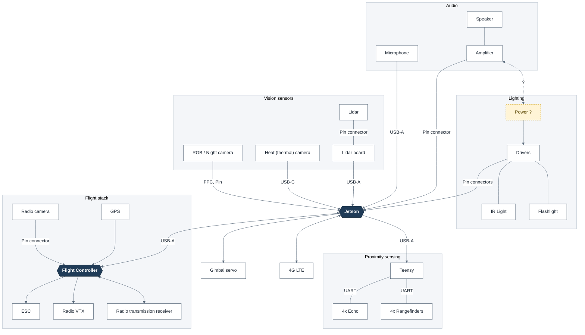

# Hardware Architecture Diagram

Digital version of the hand-drawn hardware wiring sketch. The **Jetson** is the
central companion computer; the **Flight Controller** runs the flight stack.



- Mermaid source: [`hardware-diagram.mmd`](hardware-diagram.mmd)
- Vector export: [`hardware-diagram.svg`](hardware-diagram.svg)

<details>
<summary>Live Mermaid version (renders on GitHub)</summary>



</details>

## Connections

| From | To | Interface | Notes |
|------|----|-----------|-------|
| Microphone | Jetson | USB-A | |
| Speaker | Amplifier | — | |
| Amplifier | Jetson | Pin connector | |
| Amplifier | Power | ? | Undecided in the sketch |
| Power | Drivers | — | Power source still marked "?" |
| Drivers | Flashlight, IR Light | — | |
| Drivers | Jetson | Pin connectors | |
| RGB / Night camera | Jetson | FPC, Pin | |
| Heat (thermal) camera | Jetson | USB-C | |
| Lidar | Lidar board | Pin connector | |
| Lidar board | Jetson | USB-A | |
| Jetson | Teensy | USB-A | |
| Teensy | 4x Rangefinders, 4x Echo | UART | |
| Jetson | 4G LTE | — | Bidirectional; interface not labeled in the sketch |
| Jetson | Gimbal servo | — | Interface not labeled in the sketch |
| Jetson | Flight Controller | USB-A | Bidirectional |
| Radio camera | Flight Controller | Pin connector | |
| Radio transmission receiver | Flight Controller | — | Bidirectional |
| GPS | Flight Controller | — | |
| Flight Controller | Radio VTX | — | One-way, out of the FC |
| Flight Controller | ESC | — | |

## Regenerating the images

```bash
npx -p @mermaid-js/mermaid-cli mmdc -i hardware-diagram.mmd -o hardware-diagram.png -b white -s 2
npx -p @mermaid-js/mermaid-cli mmdc -i hardware-diagram.mmd -o hardware-diagram.svg -b white
```
