# KiCad projects — Rev A

KiCad projects for the four custom boards in the
[electrical & logic design](../docs/electrical/README.md). Each one has a
complete schematic and a started PCB: board outline, mounting holes, net
classes, ground pours, and every footprint placed and grouped by circuit
block. Nothing is routed yet.

| Board | Folder | Schematic | PCB | Parts | Check results |
|-------|--------|-----------|-----|-------|---------------|
| Power Distribution Board | [`pdb/`](pdb) | [PDF](exports/pdb-schematic.pdf) (A2) | 100 × 80 mm, 4 layers · [PDF](exports/pdb-pcb.pdf) | 94 | 0 DRC violations, 189 unrouted connections |
| Jetson I/O HAT | [`hat/`](hat) | [PDF](exports/hat-schematic.pdf) (A3) | 65 × 56.5 mm, 2 layers · [PDF](exports/hat-pcb.pdf) | 38 | 0 DRC violations, 79 unrouted connections |
| Lighting Driver Board | [`lgt/`](lgt) | [PDF](exports/lgt-schematic.pdf) (A3) | 70 × 50 mm, 2 layers · [PDF](exports/lgt-pcb.pdf) | 35 | 0 DRC violations, 62 unrouted connections |
| Sensor Hub | [`sns/`](sns) | [PDF](exports/sns-schematic.pdf) (A2) | 90 × 60 mm, 2 layers · [PDF](exports/sns-pcb.pdf) | 47 | 0 DRC violations, 104 unrouted connections |

## 3D

| PDB | HAT |
|-----|-----|
| 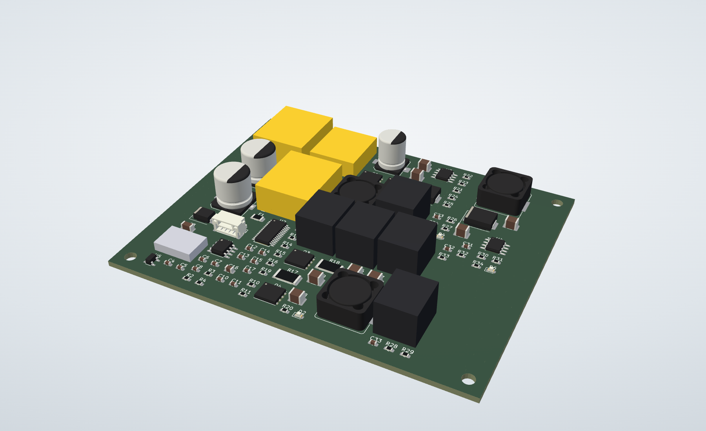 | 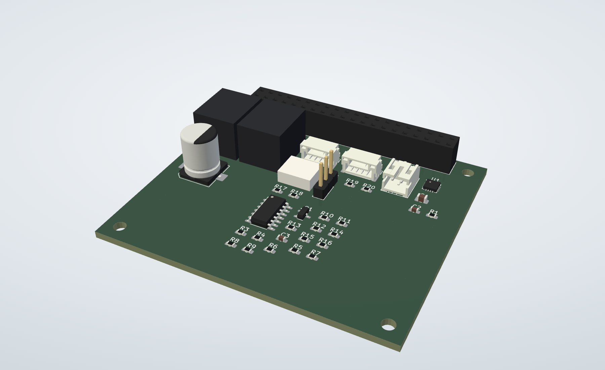 |
| **LGT** | **SNS** |
| 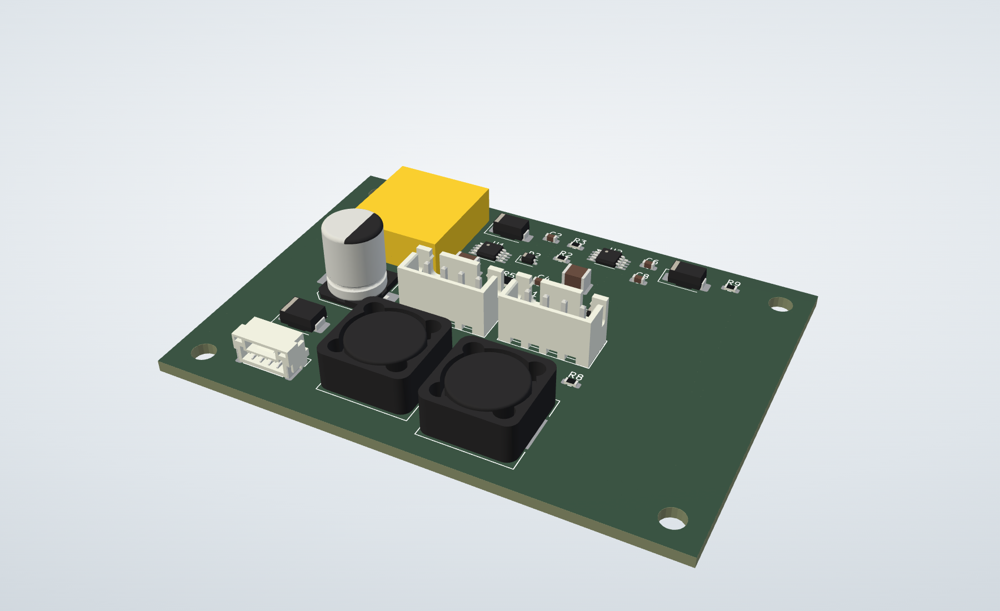 | 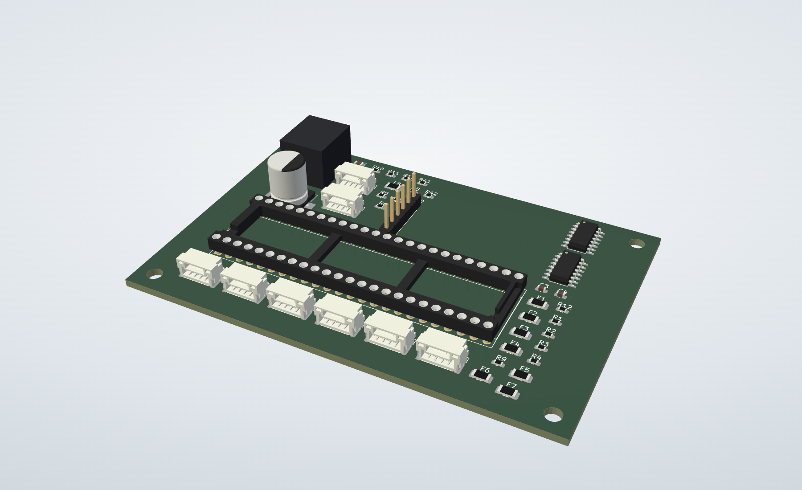 |

Exported from KiCad with its 3D model library by
[`tools/export_3d.py`](tools/export_3d.py); top views are in `exports/*-3d-top.png`.
KiCad 7's library has no models for the XT60/XT30, Micro-Fit and JST-SH
connectors or the BVR shunt, so those show as plain boxes sized from their
footprints; a few chips and inductors use the closest library model. The board
files keep their original model references. In KiCad, open *View → 3D Viewer*.

## Previews

| Board | PCB (placement, unrouted) | Schematic |
|-------|---------------------------|-----------|
| PDB | 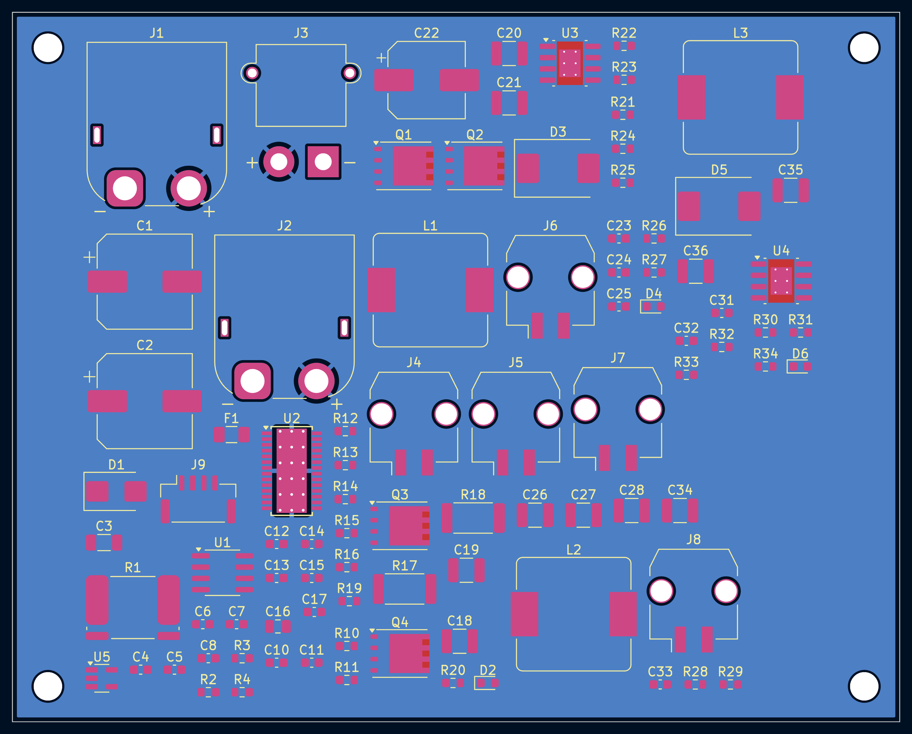 | 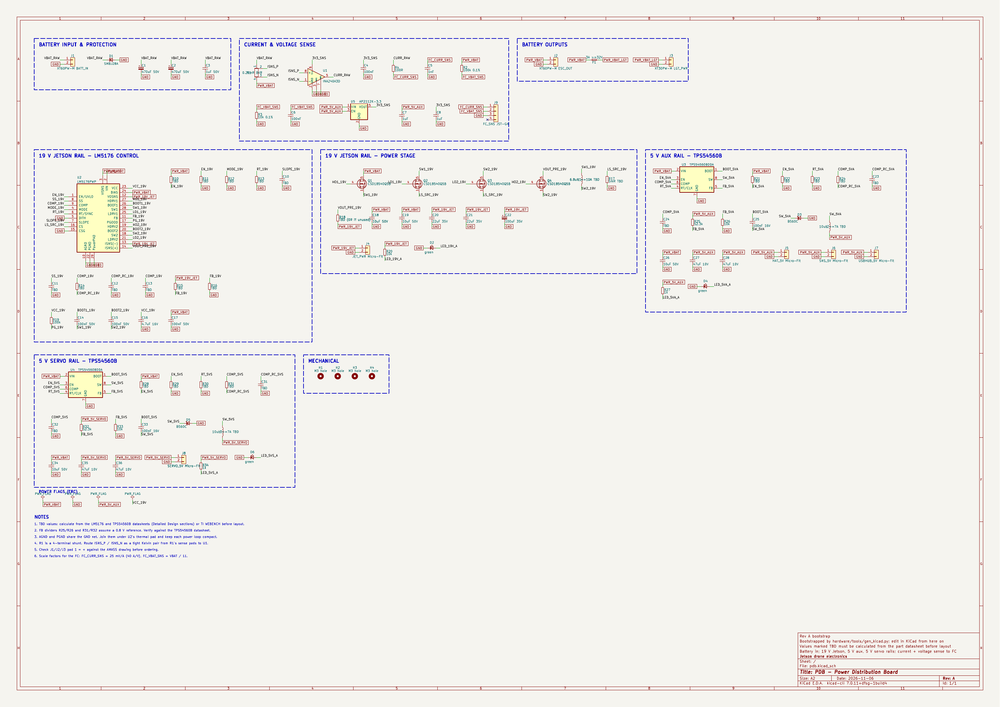 |
| HAT | 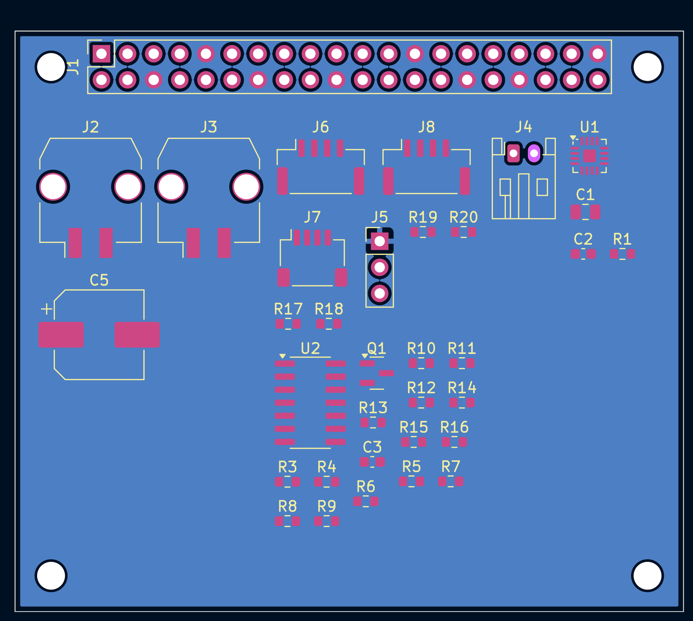 | 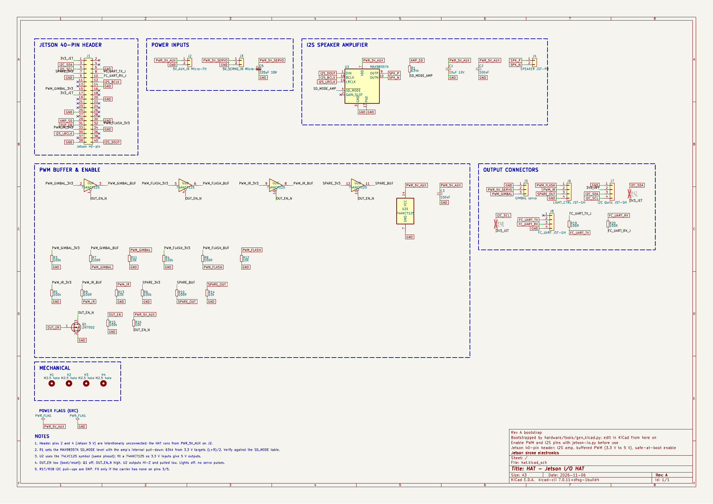 |
| LGT | 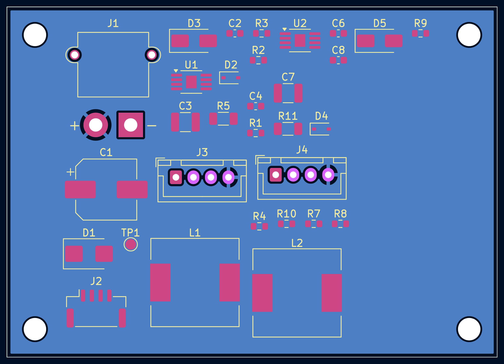 | 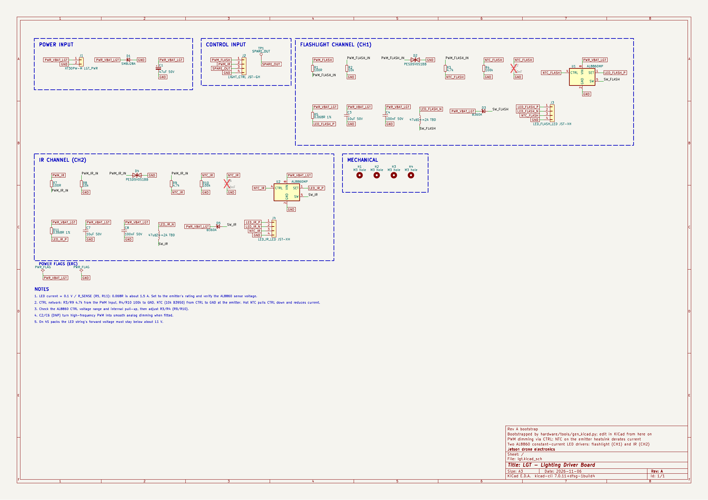 |
| SNS | 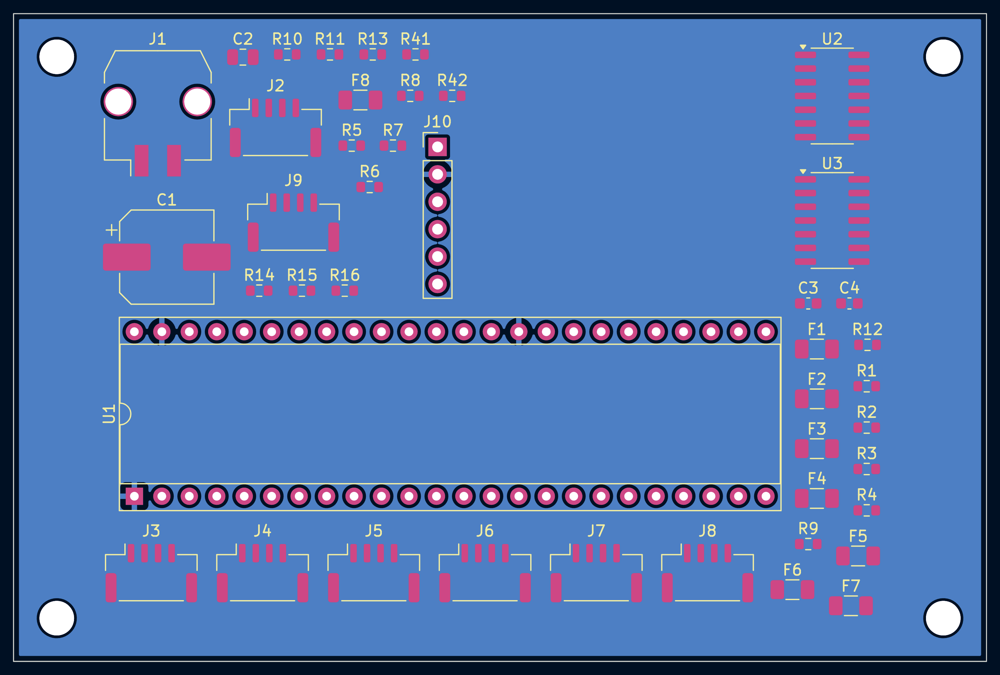 | 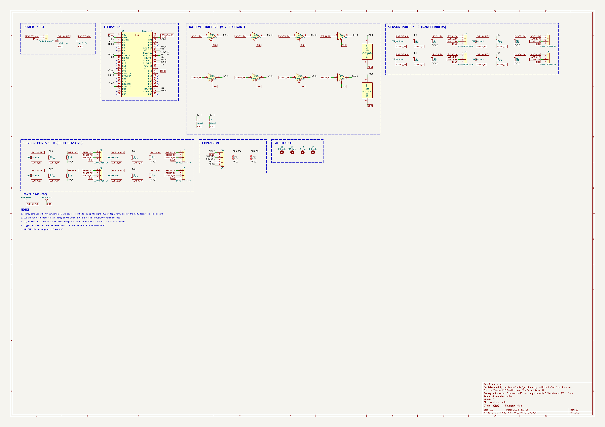 |

In the PCB images, blue is the ground fill, pink is pads and yellow is
silkscreen. Every part sits inside its outline as a starting arrangement, grouped
by circuit block; expect to rearrange them for routing.

Open the `.kicad_pro` file in **KiCad 7 or newer**. KiCad 8 and 9 upgrade the
files the first time you save.

## What's done

- **Schematics** use KiCad's standard symbols, plus a project symbol for the
  Teensy 4.1 in [`lib/drone.kicad_sym`](lib/drone.kicad_sym). Each block from
  the design doc is a labelled frame on one sheet. Every pin connects through a
  net label: global labels for nets that cross boards, using the names in
  the design doc's §3. Unused pins have no-connect flags.
- **Every pin was checked against KiCad's own netlist** (exported with
  `kicad-cli`): each pin is on the net the design intends, and no net has a
  single connection.
- **PCBs** were built from that netlist, so *Update PCB from Schematic* starts
  in sync. Every part is packed inside the outline, and each schematic block
  is a PCB group so you can select its parts together.
- **Net classes** (in each `.kicad_pro`):
  - `HighCurrent`: 3 mm track, for `PWR_VBAT` and `VBAT_RAW`.
  - `Power`: 1 mm track, for `PWR_*`, switch nodes, LED and speaker outputs, and sensor 5 V.
  - `Default`: 0.25 mm track.
  - Minimum drill is 0.2 mm, which the TI PowerPAD thermal-via footprints need.
- **Ground pours** are on `B.Cu` (and `In1.Cu` on the 4-layer PDB).
- **HAT layout:** the 40-pin socket sits along the top edge between the
  mounting holes, as on a Raspberry Pi HAT.

## Before layout: values and checks still open

Values marked **TBD** in the schematics need calculating from datasheets.
I couldn't download datasheets in the session that generated these files.

| Board | Parts | What to do |
|-------|-------|------------|
| PDB | R10–R16, C10–C13 | LM5176: EN/UVLO divider, MODE, RT (switching frequency), SLOPE, SS, compensation, FB divider for 19 V |
| PDB | L1, R17, R18, Q1–Q4 | LM5176 power stage: inductor, low-side current-sense resistor, optional output-sense resistor (0 Ω if unused), confirm CSD18540Q5B suits the chosen frequency |
| PDB | R21–R24, C23–C24, R28–R31, C31–C32, L2, L3 | TPS54560B: EN/UVLO divider, RT, compensation, inductors |
| PDB | R25/R26, R32/R33 | 52.3 k / 10 k assumes a 0.8 V feedback reference; confirm |
| PDB | J1, J2, J3 | Confirm pad 1 is + on the AMASS XT60/XT30 footprints |
| HAT | R1 (634 k) | MAX98357A SD_MODE level for (L+R)/2 mono; check the datasheet's SD_MODE table |
| HAT | U2 | Symbol is 74LVC125 (same pinout); fit a **74AHCT125** |
| LGT | R5, R11, L1, L2 | LED current (≈ 0.1 V / R) and inductor value for your emitters |
| LGT | R3/R4, R9/R10 | AL8860 CTRL voltage range and internal pull-up |
| SNS | U1 | Teensy pin numbers use DIP-48 numbering; check against the PJRC Teensy 4.1 pinout card |

Also choose the battery and motor current (shunt R1, XT60 vs XT90), and pick
final part numbers for the inductors and capacitors.

## Folder layout

```
hardware/
├── lib/drone.kicad_sym      project symbols (Teensy 4.1)
├── pdb/ hat/ lgt/ sns/      one KiCad project each (.kicad_pro, .kicad_sch, .kicad_pcb, sym-lib-table)
├── exports/                 schematic and PCB PDFs
└── tools/                   generator that bootstrapped the projects
```

## Regenerating (bootstrap only)

`tools/gen_kicad.py` holds each board's circuit as a parts-and-nets list and
writes all of the above. **It overwrites the KiCad files.** Once you start
editing in KiCad, edit the KiCad files directly and stop using the script.

It needs KiCad 7's Python module (`pcbnew`), `kiutils==1.4.8` and
`rectpack==0.2.2`:

```bash
python3 -m venv --system-site-packages .venv   # system Python that has pcbnew
.venv/bin/pip install kiutils==1.4.8 rectpack==0.2.2
.venv/bin/python hardware/tools/gen_kicad.py          # all boards
.venv/bin/python hardware/tools/gen_kicad.py lgt      # one board
```

`tools/export_3d.py <kicad 3dmodels dir> <out dir>` exports each board to VRML
with its component models (used for the 3D renders above).

